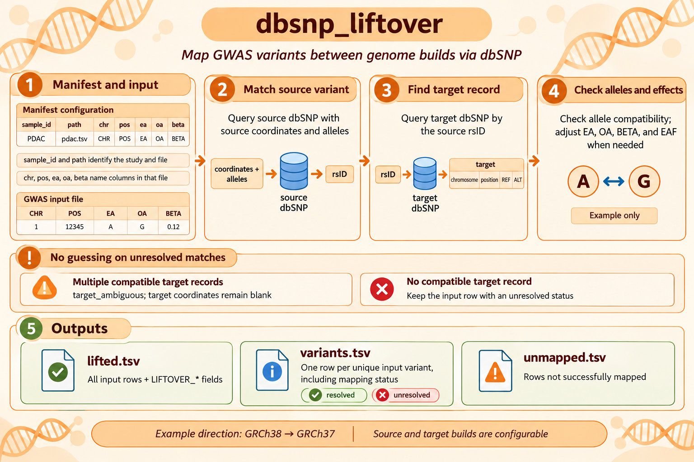

# dbSNP Liftover

A standalone, dependency-free Python project for mapping GWAS summary-statistic variants between dbSNP assembly snapshots. The same workflow supports any source/target dbSNP releases for which matching assembly snapshots are available; GRCh38-to-GRCh37 with dbSNP155 is one such configuration, not a hard-coded path.



The workflow matches input chromosome, one-based position, and source REF/ALT alleles against the source dbSNP snapshot to obtain the dbSNP rsID. It then uses that retrieved rsID—not any rsID carried by the input GWAS file—to find the matching target record and checks the alleles. It never silently chooses among ambiguous matches.

## Requirements

- Python 3.9+
- dbSNP snapshots for both assemblies: VCF (`.vcf` or `.vcf.gz`) or UCSC BigBed (`.bb`)
- No Python runtime dependencies
- BigBed mode additionally requires UCSC `bigBedToBed` and `bigBedNamedItems` executables

Install from this directory:

```bash
python -m pip install .
dbsnp-liftover --help
```

For development without installation:

```bash
PYTHONPATH=src python -m dbsnp_liftover.cli --help
```

## 1. Build source and target indexes

Build each index once, labeling the assembly and dbSNP release explicitly:

```bash
dbsnp-liftover index-vcf \
  --vcf /path/to/dbsnp155_GRCh38.vcf.gz \
  --assembly GRCh38 --release 155 \
  --output /path/to/index/dbsnp155_GRCh38.sqlite

dbsnp-liftover index-vcf \
  --vcf /path/to/dbsnp155_GRCh37.vcf.gz \
  --assembly GRCh37 --release 155 \
  --output /path/to/index/dbsnp155_GRCh37.sqlite
```

Index files are intentionally not overwritten. Use a new output path for a different snapshot. The index retains biallelic A/C/G/T/N alleles and rsIDs from VCF ID fields; symbolic alleles are skipped.

### Using UCSC BigBed snapshots directly

The project also supports UCSC BigBed files such as `dbSnp155.hg38.bb` and `dbSnp155.hg19.bb`. **Do not convert these entire files to BED/VCF first**: they can be tens of gigabytes and contain over a billion records. `convert-bigbed` queries the source BigBed by input chromosome and position, then filters those records by the supplied source REF/ALT alleles (or EA/OA if REF/ALT columns are not supplied). It obtains the source rsID from that matching dbSNP record; an rsID in the input GWAS table is never used to select the source record. It then looks up the retrieved source rsIDs in the target BigBed with `bigBedNamedItems`. Small temporary SQLite indexes are built only from the queried records and removed after conversion. Coordinate and target rsID queries are split into batches of 25,000.

Run the command from an environment where the UCSC BigBed tools are installed (for example `gwas_env`):

```bash
conda run -n gwas_env python -m pip install -e /media/lenovo/F/ZCW/DATABASE/PDAC/GWAS/dbsnp_liftover
conda run -n gwas_env dbsnp-liftover convert-bigbed \
  --manifest /path/to/manifest.tsv \
  --source-bigbed /media/lenovo/G/ZCW/DATABASE/GWAS/dbSNP155/GRCh38/dbSnp155.hg38.bb \
  --target-bigbed /media/lenovo/G/ZCW/DATABASE/GWAS/dbSNP155/GRCh37/dbSnp155.hg19.bb \
  --source-assembly GRCh38 --source-release 155 \
  --target-assembly GRCh37   --target-release 155
```

The manifest can assign each sample a directory, so `--output-dir` may be omitted. If some rows leave `output_dir` blank, supply `--output-dir` as their default. SQLite lookup indexes can also be retained by setting `database_dir` in every manifest row to the same directory, or by supplying `--database-dir`. The two files are named `source.sqlite` and `target.sqlite`; existing files are never overwritten.

Temporary query files and working SQLite indexes can be placed on a fast scratch filesystem with `--work-dir`. For example, `/dev/shm` is already a RAM-backed tmpfs on many Linux systems; check its free capacity first, and do not mount it again if it is already mounted. The indexes used during conversion are copied to `database_dir` after lookup. If no database output directory is configured, the temporary indexes are removed after the run. `--sqlite-mmap-mib` sets SQLite's memory-mapped read window (default 256 MiB; use `0` to disable). Memory mapping is not the same as placing a database in RAM and its performance benefit depends on the filesystem and workload; it is not guaranteed. A persistent index contains the records queried for that run, not all of dbSNP, so keeping it is useful for inspection/reproducibility and for converting inputs covered by those records, but it does not provide automatic resume or eliminate lookups for new variants.

Example scratch and SQLite settings:

```bash
dbsnp-liftover convert-bigbed \
  --manifest /path/to/manifest.tsv \
  --source-bigbed /path/to/dbSNP155_GRCh38.bb \
  --target-bigbed /path/to/dbSNP155_GRCh37.bb \
  --source-assembly GRCh38 --source-release 155 \
  --target-assembly GRCh37 --target-release 155 \
  --work-dir /dev/shm --sqlite-mmap-mib 512
```

If the package is already installed in the active shell:

```bash
dbsnp-liftover convert-bigbed \
  --manifest /path/to/manifest.tsv \
  --source-bigbed /media/lenovo/G/ZCW/DATABASE/GWAS/dbSNP155/GRCh38/dbSnp155.hg38.bb \
  --target-bigbed /media/lenovo/G/ZCW/DATABASE/GWAS/dbSNP155/GRCh37/dbSnp155.hg19.bb \
  --source-assembly GRCh38 --source-release 155 \
  --target-assembly GRCh37 --target-release 155 \
  --output-dir /path/to/default_lifted
```

If Python runs in a different environment, pass the UCSC executable paths with `--bigbed-to-bed` and `--bigbed-named-items`. BigBed coordinates are zero-based half-open; the program converts input one-based positions to query intervals and converts returned `chromStart` back to one-based output positions. It reads `name`, `ref`, and `alts` from the BigBed records; the `.as` file describes these fields but is not itself a variant database. Assembly and release labels are provided explicitly and recorded in output.

## 2. Configure input files

Create a tab-delimited manifest with one row per GWAS file. Required columns are `sample_id`, `path`, `chr`, `pos`, `ea`, `oa`, and `beta`. Add `output_dir` to choose a different results directory for each sample; a relative directory is resolved from the manifest's directory. If `output_dir` is blank or absent, the command-line `--output-dir` is used as the fallback. Each sample must have a directory from one of these two sources. Optional `database_dir` names the shared directory for the two persistent BigBed lookup indexes; all rows in a manifest must resolve to the same directory. It is not needed for VCF-index conversion. For the required source lookup by REF/ALT, provide `source_ref` and `source_alt` as the names of the source allele columns whenever available. If absent, the program uses the EA/OA pair as the source allele pair, but does not use any input rsID to identify the source record. Optional `rsid`, `eaf`, `se`, and `p` columns name their input columns; `rsid` is preserved in the original row but ignored for dbSNP lookup. The optional `delimiter` field overrides detection and accepts `tab`, `comma`, or `semicolon`. `path` may be absolute or relative to the manifest. Input columns are selected by their exact header names. Plain and gzip-compressed TSV/CSV files are supported; the delimiter is detected from the header when no override is given.

By default, the output files are named `{sample_id}.lifted.tsv`, `{sample_id}.variants.tsv`, and `{sample_id}.unmapped.tsv` inside that row's `output_dir`. Add `--compress-output` to either `convert` or `convert-bigbed` to write gzip-compressed `.tsv.gz` files instead. Compression uses gzip level 1 to favor throughput while substantially reducing text-file size. Gzip-compressed TSV is a widely used interchange format and is supported by many GWAS/Post-GWAS tools, but support is not universal; confirm that downstream software accepts `.tsv.gz` before choosing it. Existing output files are never overwritten, and the program rejects manifests whose rows resolve to colliding output paths.

For example:

```bash
dbsnp-liftover convert-bigbed \
  --manifest /path/to/manifest.tsv \
  --source-bigbed /path/to/dbSNP_GRCh38.bb \
  --target-bigbed /path/to/dbSNP_GRCh37.bb \
  --source-assembly GRCh38 --source-release 155 \
  --target-assembly GRCh37 --target-release 155 \
  --compress-output
```

See [`examples/manifest.tsv`](examples/manifest.tsv) for a template. Coordinates must be one-based. Alleles are uppercased, `chr` prefixes and mitochondrial chromosome names are canonicalized, and direct or reverse-complement source REF/ALT and EA/OA pairs are recognized. Alleles should be represented in a form that matches the dbSNP records; indel normalization beyond the snapshot's representation is not inferred.

## 3. Convert

```bash
dbsnp-liftover convert \
  --manifest /path/to/manifest.tsv \
  --source-index /path/to/index/dbsnp155_GRCh38.sqlite \
  --target-index /path/to/index/dbsnp155_GRCh37.sqlite
```

The `convert` mode follows the same per-sample `output_dir` and `--output-dir` fallback rules as `convert-bigbed`.

For each manifest row, the output directory receives:

- `{sample_id}.lifted.tsv` (or `.lifted.tsv.gz` with `--compress-output`): all original columns plus `LIFTOVER_*` fields. `LIFTOVER_EA/OA` are standardized to target ALT/REF; `LIFTOVER_BETA` is direction-adjusted when needed; `LIFTOVER_EAF` is changed to `1-EAF` when the effect direction flips. Source/target assembly and dbSNP release labels are included. Original columns remain unchanged.
- `{sample_id}.variants.tsv` (or `.variants.tsv.gz` with `--compress-output`): one row per unique input `(CHR, POS, EA, OA)` combination, including a stable within-file `LIFTOVER_VARIANT_ID`, mapping status, target coordinates/alleles, and source/target assembly/release labels. The row-level file carries the same ID so duplicate input rows can be traced back to the unique-variant table.
- `{sample_id}.unmapped.tsv` (or `.unmapped.tsv.gz` with `--compress-output`): original input rows plus `LIFTOVER_*` fields for rows whose mapping status is not `mapped` or `mapped_flip`. This makes unresolved rows easy to review and submit to a different liftover workflow. Rows with `mapped_invalid_beta`, `mapped_invalid_eaf`, or `mapped_invalid_beta_eaf` are not included: their coordinates mapped, but one or more effect statistics could not be safely adjusted.

Non-primary target chromosomes are included by default. Add `--primary-only` to exclude non-primary target candidates (1-22, X, Y, and MT are primary). If a target match exists only on non-primary chromosomes, the row is reported as `target_non_primary_only` and remains in the output and unmapped file without target coordinates. When primary-only mode leaves multiple compatible primary candidates, the result remains `target_ambiguous`.

Target matches are otherwise strict by default: if more than one allele-compatible target record exists, the result is `target_ambiguous`. Add `--prefer-unique-primary` to prefer a primary-chromosome record when resolving multiple matches. This option selects a result only when exactly one compatible candidate is on a primary chromosome; if there are zero or multiple primary candidates, the result remains ambiguous. Unlike `--primary-only`, it does not exclude a sole non-primary candidate.

Multiple source rsIDs are strict by default: any input matching more than one source dbSNP record is `source_ambiguous`. Add `--allow-partial-source-rsids` to query all candidate rsIDs in the target index. With this option, mapping is accepted when at least one source rsID has a unique target mapping, all uniquely mapped candidates agree on target chromosome, position, REF/ALT, and effect direction, and every remaining candidate has no compatible target mapping. A candidate with an ambiguous target match, or candidates that map to different target results, keep the input `source_ambiguous`. The resolved row reports all candidate source rsIDs, sorted and separated by semicolons; `LIFTOVER_NOTE` identifies candidate IDs with no compatible target mapping. If no candidates map, the source remains ambiguous.

Typical status values include `mapped`, `mapped_flip`, `source_variant_not_found`, `source_ambiguous`, `source_allele_conflict`, `target_variant_not_found`, `target_non_primary_only`, `target_ambiguous`, and `invalid_input`. Invalid BETA/EAF values that cannot safely be flipped are flagged as `mapped_invalid_beta`, `mapped_invalid_eaf`, or `mapped_invalid_beta_eaf`. Unmapped output fields are left blank rather than populated with guessed coordinates.

## Matching limits and provenance

- Source matching uses normalized chromosome, one-based position, and source REF/ALT (or EA/OA when explicit REF/ALT columns are not supplied). The input rsID is never trusted or used to select the source record; the rsID is obtained from the source dbSNP record itself.
- A target match requires the same dbSNP rsID and allele pair (direct or reverse-complemented). A unique coordinate and allele match is required; merged IDs, multi-mapping, unresolved indel representation differences, and other cases without a unique pair are reported as unmatched or ambiguous.
- This is dbSNP-mediated mapping, not a general chain-file liftover service. It does not normalize indels against a reference genome or infer mappings for variants absent from either snapshot.
- Each VCF SQLite index or temporary BigBed lookup records its assembly and dbSNP release. Keep the original snapshots and record their checksums alongside the results for reproducibility.

## Example results: FinnGen R10 periodontitis

A FinnGen R10 periodontitis dataset was processed with dbSNP 155 to map 7,126,593 input rows from GRCh38 to GRCh37. A mapping was reported for 7,101,013 rows (99.641%); 25,580 rows (0.359%) did not receive an accepted mapping.

The unresolved rows were classified as follows:

| Mapping status | Rows | Interpretation |
|---|---:|---|
| `target_variant_not_found` | 23,813 | A matching target variant was not found in the target dbSNP snapshot. |
| `target_ambiguous` | 926 | More than one compatible target match remained. |
| `source_variant_not_found` | 838 | The source variant could not be matched in the source dbSNP snapshot. |
| `source_ambiguous` | 3 | More than one source dbSNP record matched the input. |

These statuses describe the outcome of the project's matching rules. An unresolved row is not necessarily an invalid variant; it means that this run did not establish a unique, acceptable mapping.

The results are tab-separated tables with three complementary views:

- **Row-level results** retain every input row and its original columns, then add mapping status, target variant and assembly information, and target-oriented effect fields. For example, target chromosome, position, REF, and ALT describe the GRCh37 mapping; effect alleles, BETA, and EAF are adjusted to the target allele orientation when required. Target mapping fields are blank when no mapping was accepted.
- **Unique-variant results** contain one record per distinct input chromosome, position, and allele combination. Each record summarizes its mapping status and target information and has a stable variant identifier that can be used to connect it to the row-level results.
- **Unresolved-row results** retain the original input data for rows without an accepted mapping, together with the status and any explanatory note. These records can be reviewed or handled separately without guessing target coordinates.

The original input `BUILD` values indicated GRCh37, whereas the run configuration treated the source coordinates as GRCh38. Since original columns are preserved, interpret the conversion using the added liftover fields and their assembly labels rather than the input `BUILD` value.

The run's validation report recorded successful gzip-integrity and row-preservation checks. These checks do not independently validate coordinates against a GRCh38 reference FASTA; that validation remains outstanding. The command also returned a non-zero exit code after a temporary-directory cleanup failure, despite the reported output checks passing.

## Tests

```bash
PYTHONPATH=src python -m unittest discover -s tests -v
```
